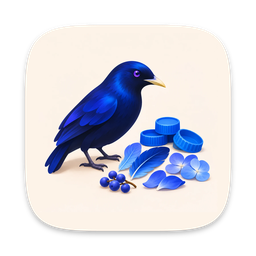

# Bowerbird

[English](README.md) | 日本語

macOS 向けのネイティブ・ローカル完結な [Eagle](https://eagle.cool) 代替アプリです。画像や動画などの資料を集め、フォルダ・タグ・スマートフォルダで整理し、テキスト・色・画像内の文字（OCR）からすばやく探せます。ライブラリは自分の Mac 上に通常のフォルダ、または暗号化した状態で保存できます。

名前の由来はニワシドリ（bowerbird）です。集めたものを色ごとに並べてあずまや（bower）を飾る習性にちなんでいます。

このリポジトリはアプリの配布用です。ソースコードは非公開リポジトリで管理しています。

## できること

- **集める**: ドラッグ＆ドロップ、クリップボードからの貼り付け、ブラウザ拡張、スクリーンショット、Finder のフォルダ階層そのままの取り込みに対応しています。Web ページは 1 つの完結したファイルとして保存できます。yt-dlp / gallery-dl のサイドカー（`.info.json`）や `.xmp`、`.txt` からはタイトル・メモ・タグも一緒に取り込めます。
- **対応形式**: 画像（アニメーション GIF を含む）、動画・音声（libmpv）、PDF、SVG、3D モデル（USDZ / OBJ / STL / PLY）、Web ブックマーク。
- **整理する**: 階層フォルダ（1 つのアイテムを複数フォルダに所属可能）、タグ、メモ、元 URL、スマートフォルダ、一括リネーム、すべての編集に対する取り消し（Undo）。画像への矩形・点・フリーハンド注釈や、動画の特定の再生位置へのメモ付けもできます。
- **探す**: タイトル・タグ・フォルダ・メモ・注釈・URL に加え、画像内の文字認識（日本語・英語 OCR）を横断検索できます。種類・タグ・サイズ・再生時間・色による絞り込みや、類似画像検索にも対応しています。
- **見る**: グリッド／リスト表示、ズームや再生ができるステージ表示、スライドショー。
- **持ち運ぶ・連携する**: 複数のライブラリを並べて扱い、ライブラリ間でコピー／移動できます。タグ・フォルダ・メモを保持したまま別の Mac へ渡せるパック書き出しや、スクリプト向けのローカル HTTP API も備えています。
- **手元に残す**: 任意で Google Drive にコピーを追加しない限り、ライブラリはこの Mac 内に留まります。暗号化ライブラリには 24 語のリカバリフレーズが発行されます。

## インストール

```sh
curl -fsSL https://raw.githubusercontent.com/mktbsh/bowerbird/main/install.sh | sh
```

[`install.sh`](install.sh) は最新リリースをダウンロードし、Bowerbird のリリース証明書で署名されていることを検証したうえで `Bowerbird.app` を `/Applications` に配置して起動します。実行前に中身を確認しても構いません。別の場所に置きたい場合は `BOWERBIRD_INSTALL_DIR=~/Applications` を指定できます。再度実行すると、新しいリリースがあれば更新されます。

`curl` 経由でダウンロードしたファイルにはインターネット経由の隔離属性（quarantine）が付かないため、Apple Developer ID ではなく独自のリリース証明書で署名されていても Gatekeeper に止められず起動できます。

<details>
<summary>zip を手動でインストールする場合</summary>

1. [Releases](../../releases) から最新の `Bowerbird-<version>.zip` をダウンロードして展開します。
2. `Bowerbird.app` を `/Applications` に移動します。
3. ブラウザ経由のダウンロードには隔離属性が付くため、初回起動時に Gatekeeper が止めます。次のコマンドで一度だけ解除するか、

   ```sh
   xattr -dr com.apple.quarantine /Applications/Bowerbird.app
   ```

   アプリを開こうとした後、「システム設定 ▸ プライバシーとセキュリティ」から「このまま開く」を選んでください。

</details>

インストール後は、アプリ自身がこのリポジトリの Releases を確認して自動更新します（設定 ▸ About ▸ Updates）。同じリリース証明書で署名されたビルド以外はインストールしません。

バージョン表記はリリース日（`YYYY.M.D`、同日の再リリースは `.N` 付き）です。

動作要件: Apple Silicon 搭載 Mac、macOS 14 以降。

## プライバシー・セキュリティ・署名について

- **Apple Developer ID / 公証（Notarization）について**: 現在のリリースは Apple Developer ID ではなく、Bowerbird 独自のリリース証明書（`SHA-1: A8CE2558390C191B685C7B926A1DCFFF9FF0C727`）で署名しています。[`install.sh`](install.sh) とアプリ内蔵アップデータの双方が、Bundle ID（`app.bowerbird.macos`）とこの証明書の一致を厳格に検証し、一致しないビルドはインストールしません。現状は作者の個人利用で満足しているため Apple Developer Program には加入していませんが、**公証済みビルドの需要があれば Apple Developer ID での署名・公証に対応する予定です**。希望される方は [Issues](../../issues) でお知らせください。
- **`curl | sh` を使いたくない場合**: [`install.sh`](install.sh) の内容を確認してから実行するか、スクリプトを使わず上の「zip を手動でインストールする場合」の手順で導入できます。
- **ソース非公開について**: ソースコードは非公開リポジトリにあり、このリポジトリでは署名済みアプリとインストーラのみを公開しています。
- **通信とテレメトリ**: アカウント登録・アクセス解析・テレメトリ送信は一切ありません。外部へ通信するのは次の場合のみです。
  - このリポジトリの GitHub Releases からのアップデート確認・ダウンロード
  - ユーザーが明示的にブックマーク保存した Web ページの取得（保存時にスクリプトと外部参照は除去します）
  - ユーザーが任意で連携を設定した場合の Google Drive 同期（`drive.file` スコープのみ）
- **ローカル HTTP API**: `127.0.0.1` のみで待ち受け、Bearer トークン必須（読み取り専用と書き込み用で別トークン）です。CORS ヘッダーはブラウザ拡張の Origin にのみ返します。
- **暗号化**: 暗号化ライブラリでは、24 語の BIP39 リカバリフレーズに紐づく 32 バイトのマスターキーと AES-GCM を用いてファイル本体とメタデータをローカルで暗号化します。

## フィードバック

不具合報告・質問・要望（公証対応や移行機能のリクエストなど）は [Issues](../../issues) までお寄せください。

Bowerbird は Eagle とは無関係のプロジェクトです。
